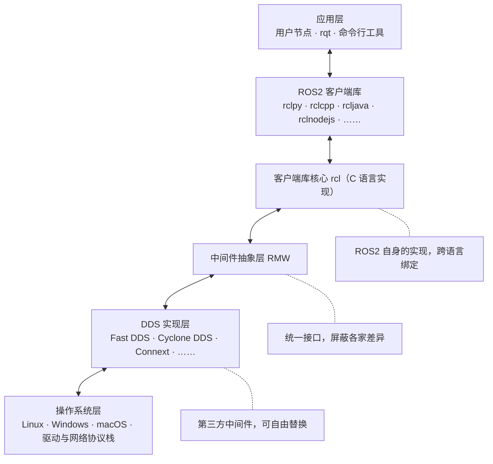
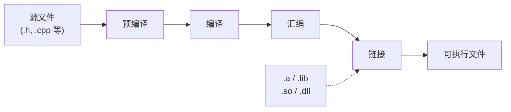

# ROS2 体验与系统架构

## ROS2 体验

### 你说我听

游戏内容：很简单，我们启动两个节点，一个节点负责发消息(说)，一个节点负责收消息（听）。

1. 启动一个终端，快捷键 `Ctrl+Alt+T`。
2. 在终端中启动倾听者：`ros2 run demo_nodes_py listener`
3. 再启动一个新终端，快捷键 `Ctrl+Alt+T`。
4. 在新终端中启动说话者：`ros2 run demo_nodes_cpp talker`

观察一下现象，talker节点每数一个输，倾听节点每一次都能听到一个，是不是很神奇。
![[你说我听.png]]

*图：你说我听*

### 涂鸦乌龟

打开终端Ctrl+Alt+T,输入下面的指令

**启动海龟画图**

```bash
ros2 run turtlesim turtlesim_node
```

如下图所示：
![[海龟模拟器.png]]

*图：海龟模拟器*

点一下原来的终端输入Ctrl+Shift+T 打开一个新的标签页输入

**启动海龟操控**

```bash
ros2 run turtlesim turtle_teleop_key
```

### RQT可视化

保持前面两个游戏在运行状态，打开终端，输入rqt。打开之后选择插件Introspection / Node Graph，刷新一下，即可看见两个节点间的通信关系。

![[RQT Node Graph 可视化.png]]
*图：RQT Node Graph 可视化*

## ROS2 系统架构

前面两个小游戏你已经玩过了，节点能跑起来，rqt 里也能看到它们之间的连线。不过这些都还停留在“会用”的层面。这一节我们把 ROS2 拆开，从整体框架上看一看它到底由哪几层构成，以及为什么要这样分层。

### 分层架构总览

ROS2 的整体结构可以用一张“千层饼”式的图来描述，从上到下依次是：应用层、ROS2 客户端库、客户端库核心 rcl、中间件抽象层 RMW、DDS 实现层、操作系统层。相邻两层之间是双向的调用关系：上层向下层提出请求，下层把结果和事件回传给上层。



*图：ROS2 的分层架构。自下而上依次是操作系统层、DDS 实现层、中间件抽象层 RMW、客户端库 RCL 以及最顶端的应用层，相邻两层之间为双向调用关系*

图中的注释标出了各层的归属：从应用层到客户端库核心 rcl，这三层是 ROS2 官方自己实现的；中间件抽象层 RMW 是统一接口；最下面的 DDS 实现层则来自第三方。接下来我们自下而上，一层一层地看。

### 操作系统层

这一层最好理解。ROS2 自己并不是一个操作系统，它只是跑在 Linux、Windows 或 macOS 之上的一个中间件框架。真正去驱动硬件、管理进程、收发底层网络数据包这些脏活累活，全部交给操作系统来完成。也正因为如此，ROS2 才能在这么多平台上跑起来：只要那个平台提供的系统调用和网络协议栈足够完整，上面的各层就可以原封不动地搬过去。

顺带说一句，我们在前面折腾 WSL 里的 Ubuntu，其实就是在给上面的几层准备一块合适的“地基”。

### DDS 实现层

想弄懂这一层，你得先回答两个问题：DDS 到底是什么？以及为什么 ROS2 里会同时存在好几套 DDS 实现？

#### DDS 是什么

DDS，全称 Data Distribution Service，中文叫“数据分发服务”，是由对象管理组 OMG（Object Management Group）在 2003 年发布、2007 年修订的一套分布式系统通信标准。

它的通信方式和 ROS 里的话题发布订阅几乎一模一样：一方把数据“发布”到某个主题上，关心这个主题的另一方“订阅”后就能收到，双方不需要事先知道对方是谁。除此之外，DDS 还提供了相当丰富的服务质量（QoS）策略，用来规定通信的可靠性、持久性、传输方式等要求。

正因为设计理念如此契合，ROS2 干脆不再自己另造一套通信协议，而是直接把 DDS 拿来当作底层的通信支柱。

#### 为什么会有多套 DDS 实现

DDS 只是一份标准文档，标准本身不能运行，得有人照着它写出真正的程序，这些程序就叫“DDS 实现”。目前常见的实现有 eProsima 的 Fast DDS、Eclipse 的 Cyclone DDS、RTI 的 Connext DDS 等。它们遵守同一份标准，但侧重点各不相同：有的偏重性能，有的体积小巧，有的面向商用场景提供技术支持。

既然标准是统一的，那多准备几套实现就不会给上层添麻烦，想换随时换。至于这些差异是怎么被“抹平”的，就要看下面这一层了。

### 中间件抽象层 RMW

RMW 是 ROS Middleware 的缩写，也就是中间件抽象层。它的作用可以用一句话概括：**给上面一个统一的接口，把下面各家的差异藏起来**。

为什么不直接把 DDS 暴露给上层呢？因为直接用 DDS 其实挺麻烦的。创建一次通信要设置分区、主题名称、发现模式、消息类型等一大堆参数，还要记得在不用的时候逐项清理。这些琐碎而重复的配置如果让每个写节点的同学自己处理，代码会变得又臭又长。

于是 ROS2 在这中间加了一层 RMW：它定义好一套固定的接口，无论底下换成 Fast DDS 还是 Cyclone DDS，上层看到的 API 都完全一样。那些繁琐的配置也就顺理成章地在 RMW 和 RCL 里统一完成了。

**查看与切换 DDS 实现**

```bash
# 查看当前使用的 DDS 实现
ros2 doctor --report | grep middleware

# 通过环境变量切换（需要系统里已安装对应的 DDS）
export RMW_IMPLEMENTATION=rmw_cyclonedds_cpp
```

### 客户端库 RCL 与语言绑定

RCL 是 ROS Client Library 的缩写，也就是 ROS2 客户端库。它建立在 RMW 之上，把 ROS 里的节点、话题、服务、参数、Action 这些概念包装成一套好用的 API。

这里有个细节值得留意：RCL 的底层实现是用 C 语言写的，因为 C 是众多高级语言的“共同祖先”，基于它再去封装其它语言会轻松很多。所以官方的 rclpy（Python）和 rclcpp（C++）都是直接建立在这套 C 实现之上的。这也是为什么后面我们用两种语言写节点时，代码结构会如此相似。

社区还用同样的方式把 ROS2 搬到了更多语言和平台上，比如在 Android 应用或网页里也能和 ROS2 通信：

| 语言 | 客户端库 | 项目地址 |
| --- | --- | --- |
| Python | rclpy | <https://github.com/ros2/rclpy> |
| C++ | rclcpp | <https://github.com/ros2/rclcpp> |
| Java | rcljava | <https://github.com/esteve/ros2_java> |
| Rust | rclrust | <https://github.com/ros2-rust/ros2_rust> |
| Node.js | rclnodejs | <https://github.com/RobotWebTools/rclnodejs> |
| Go | rclgo | <https://github.com/juaruipav/rclgo> |
| Lua | rcllua | <https://github.com/jbbjarnason/rcllua> |
| Kotlin | rclkin | <https://github.com/ros2java-alfred/ros2_kotlin> |
| Swift | rclswift | <https://github.com/atyshka/ros2_swift> |
| C# | rclcs | <https://github.com/RobotecAI/ros2cs> |

*表：ROS2 的常见多语言客户端库*

### 应用层

最上面就是我们自己写代码、以及 rqt、命令行工具这些开发工具所在的层了。后面写的所有节点代码，其实都住在这里。它们不需要关心底下的通信是怎么实现的，只要调用客户端库提供的 API 就好，这也正是分层带来的好处。

## ROS2 中间件 DDS 架构

### 中间件

中间件是一种独立的系统软件或服务程序，分布式应用软件借助这种软件在不同的技术之间共享资源。中间件位于客户机/ 服务器的操作系统之上，管理计算机资源和网络通讯。是连接两个独立应用程序或独立系统的软件。相连接的系统，即使它们具有不同的接口，但通过中间件相互之间仍能交换信息。执行中间件的一个关键途径是信息传递。通过中间件，应用程序可以工作于多平台或OS环境。

![[熊猫表情.jpg]]
*图：这是在说什么，怎么一个字都听不懂（）*

## DDS 和 ROS2 架构

ROS2为每家DDS供应商都开发了对应的`DDS_Interface`即DDS接口层，然后通过DDS Abstract抽象层来统一DDS的API。

![[ROS2DDS架构.png]]
*图：ROS2DDS架构*

## DDS 通信模型

核心模型DCPS：以数据为中心的发布订阅。

DCPS模型通过主题实现发布者与订阅者的解耦，核心构成包括：

- 域（Domain）：作为逻辑隔离的通信平面，只有相同域ID下的节点才能互相发现和通信，解决多系统同网络下的隔离问题。
- 主题（Topic）：是连接发布者与订阅者的逻辑纽带，对数据做分类标记，是发布和订阅匹配的唯一依据，发布者只需要发布对应主题的数据，所有订阅该主题的节点都会自动收到数据。
- 发布者/数据写入器（Publisher/DataWriter）：由发布者创建DataWriter，实际负责数据的发送。
- 订阅者/数据读取器（Subscriber/DataReader）：由订阅者创建DataReader，实际负责接收对应主题的数据。

这种模式下发布者和订阅者不需要知道对方的地址信息，仅通过主题完成匹配，能够轻松构建复杂的多对多通信关系，实现系统的高度解耦。

## ROS2 的节点

### 使用 g++ 编译 ROS2 节点

程序编译一般需要经预处理、编译、汇编和链接几个步骤。在实际应用中，有些公共代码需要反复使用，就把这些代码编译成为“库”文件。在链接步骤中，链接器将从库文件取得所需的代码，复制到生成的可执行文件中，这种库称为静态（链接）库，其特点是可执行文件中包含了库代码的一份完整拷贝，缺点是被多次使用就会多份冗余拷贝。还有一种库，就是程序在开始运行后调用库函数时才被载入，这种库独立于现有的程序，其本身不可执行，但包含着程序需要调用的一些函数，这种库称为动态（链接）库（*Dynamic Link Library*）。



*图：编译链接流程*

静态库、动态库的区别来自【链接阶段】如何处理库，链接成可执行程序，分别称为静态链接方式、动态链接方式。

在widows平台下，静态链接库是.lib文件，动态库文件是.dll文件。在linux平台下，静态链接库是.a文件，动态链接库是.so文件。

正确做法是用 ament 包构建，见 [[使用CMake + ament编译ROS2节点]]。
